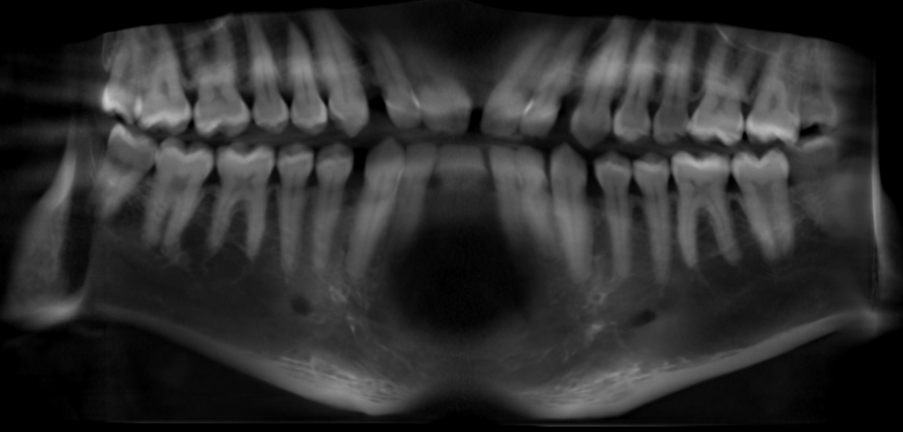

# Dental Scan Viewer 🦷

**Open a dental 3D (CBCT) scan in any browser: phone, Mac, Windows or Linux. Nothing is uploaded.**

👉 **Live:** https://tatendaz.github.io/dental-scan-viewer/



🎬 [Watch the 50-second demo](demo/demo-video.mp4)

## Why this exists

I went to the dentist with pain in my left jaw. They took a 3D cone-beam CT scan and sent it to me as
a `.rar` archive containing a Windows-only viewer (Planmeca Romexis) and a 335 MB DICOM file. My
phone couldn't open it, and neither could my Mac.

So I gave the link to Claude. It downloaded and unpacked the archive, worked out what the files
were, and built this viewer so I could actually look at my own scan. It also read the scan and gave
me a (non-medical) opinion on what it saw. This repo is that viewer, with my anonymized scan as the demo.

## What it does

- **Three views:** top-down, front and side slices that stay linked. Click or tap anywhere to move the others there.
- **Presets** for teeth, bone and soft tissue, plus brightness and contrast sliders.
- **X-ray view:** flattens the whole volume into an X-ray-like projection from each direction.
- **Measure** distances in millimetres (Shift + drag).
- **Opens what dentists hand out:** a raw `.dcm`, a gzipped `.dcm.gz`, or a gzip split into
  `.part0`, `.part1`, … files (select them all at once).
- **Private by design:** the scan is decoded in your browser with plain JavaScript. There is no server, no analytics and no upload.
- **Works offline:** download [`dist/dental-scan-viewer.html`](dist/dental-scan-viewer.html) and open it from disk.

## Using it with your own scan

1. Find the `.dcm` file in what your dentist gave you. With Planmeca Romexis exports it's under
   `data/images/<your name>/`. Unpack `.rar` files first (The Unarchiver on Mac, 7-Zip on Windows).
2. Open the [live viewer](https://tatendaz.github.io/dental-scan-viewer/) and drop the file in.
3. If the front and side views come out upside down (some scanners store slices bottom-up), press **Flip vertical**.

Large scans are big: a 551³ volume needs about 350 MB of memory, which recent phones handle but older ones may not.

## Limits

- Single multi-frame, uncompressed, 16-bit DICOM files, which is what CBCT exports usually are.
  JPEG-compressed DICOM and folders of single-slice files aren't supported yet.
- Left/right labels assume the standard radiology layout. The demo file doesn't record orientation.
- **This is a viewer for curiosity, not a diagnostic tool.** Talk to your dentist about anything you see.

## The demo scan

`demo/demo-scan.dcm.gz` is my real scan, rebuilt as a new DICOM with no personal details (no name,
IDs, dates or clinic), cropped and downsampled from 0.2 mm to 0.4 mm voxels so it loads quickly.

## Development

No build step for the site: `index.html` imports `dicom.js` directly.

```sh
npm test         # node:test unit tests for the DICOM parser and the standalone build
npm run build    # regenerate dist/dental-scan-viewer.html (single file, works from file://)
npm start        # serve locally on http://localhost:8080
```

Built with [Claude](https://claude.ai). MIT licensed.
